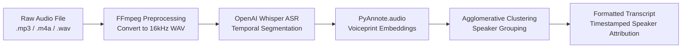

# Speech-to-Text & Speaker Diarization using OpenAI Whisper + PyAnnote

[](https://www.python.org/)
[](https://github.com/openai/whisper)
[](https://github.com/pyannote/pyannote-audio)
[](https://scikit-learn.org/)
[](https://colab.research.google.com/github/rishvaanthar/Text-to-speech-using-Whisper-AI/blob/main/filetext.ipynb)

An end-to-end **Automated Speech Recognition (ASR) and Speaker Diarization Pipeline**. This project transcribes audio into text while automatically detecting, identifying, and attributing speech segments to distinct speakers with millisecond-accurate timestamps (`"Who spoke when"`).

---

## 📌 Architecture & Workflow



### 1. Audio Preprocessing
Uses `ffmpeg` to normalize input audio of any format (`.mp3`, `.m4a`, `.ogg`, `.flac`) into uniform single-channel uncompressed WAV format (`audio.wav`).

### 2. Automatic Speech Recognition (ASR)
Leverages **OpenAI Whisper** (`tiny`, `base`, `small`, `medium`, or `large`) to perform robust transcription with start and end timestamps for every sentence segment:
```python
model = whisper.load_model("base")
result = model.transcribe("audio.wav")
segments = result["segments"]
```

### 3. Voiceprint Embedding Extraction
Uses **PyAnnote Audio** neural acoustic feature extractors to map each spoken segment into a **192-dimensional speaker embedding vector** representing unique vocal characteristics.

### 4. Unsupervised Speaker Diarization
Applies **Agglomerative Hierarchical Clustering** from `scikit-learn` to cluster embedding vectors according to the specified number of speakers:
```python
from sklearn.cluster import AgglomerativeClustering
clustering = AgglomerativeClustering(num_speakers).fit(embeddings)
labels = clustering.labels_
```

### 5. Transcript Synthesis
Merges consecutive speech chunks from the same speaker, maps timestamps into readable `HH:MM:SS` format, and outputs a formatted file (`transcript.txt`).

---

## 📄 Sample Output

```text
0:00:01 SPEAKER 1: Hello everyone, welcome to our quarterly engineering review.
0:00:07 SPEAKER 2: Thank you. Today I will be walking through our machine learning infrastructure milestones.
0:00:15 SPEAKER 1: Perfect, let's start with the latency improvements on the inference pipeline.
0:00:23 SPEAKER 2: As you can see on slide four, we reduced average response latency by 35%.
```

---

## 🚀 Getting Started

### Option 1: Run in Google Colab (Recommended)
Click the badge below to open and run directly in Google Colab with free GPU acceleration:

[](https://colab.research.google.com/github/rishvaanthar/Text-to-speech-using-Whisper-AI/blob/main/filetext.ipynb)

1. Select **Runtime** > **Change runtime type** > Choose **T4 GPU**.
2. Run the cells sequentially.
3. Upload your audio file when prompted.
4. Set the number of speakers (`num_speakers = 2`) and preferred Whisper model size (`base`, `small`, `medium`).
5. Download your generated `transcript.txt`.

---

### Option 2: Run Locally

#### 1. System Requirements
- **Python**: 3.8 to 3.11
- **FFmpeg**: Must be installed and available on system `PATH`.
  - **Ubuntu / Debian**: `sudo apt update && sudo apt install ffmpeg`
  - **macOS (Homebrew)**: `brew install ffmpeg`
  - **Windows (Chocolatey / Winget)**: `winget install Gyan.FFmpeg`

#### 2. Install Dependencies
```bash
pip install -q git+https://github.com/openai/whisper.git
pip install -q git+https://github.com/pyannote/pyannote-audio
pip install scikit-learn numpy
```

#### 3. Execute Notebook or Python Script
Launch Jupyter to run `filetext.ipynb`:
```bash
jupyter notebook filetext.ipynb
```

---

## ⚙️ Configurable Parameters

| Parameter | Type | Default | Options | Description |
| :--- | :--- | :--- | :--- | :--- |
| `num_speakers` | Integer | `2` | `1, 2, 3, ...` | Number of distinct speakers participating in the audio conversation. |
| `language` | String | `'any'` | `'any'`, `'English'` | Target language code for Whisper transcription. |
| `model_size` | String | `'base'` | `'tiny'`, `'base'`, `'small'`, `'medium'`, `'large'` | Whisper model checkpoint balance between speed and transcription accuracy. |

---

## 🛠️ Tech Stack & Libraries

- **[OpenAI Whisper](https://github.com/openai/whisper)**: Sequence-to-sequence transformer model trained on 680,000 hours of multilingual audio.
- **[PyAnnote.audio](https://github.com/pyannote/pyannote-audio)**: Neural building blocks for speaker diarization and voice embedding extraction.
- **[Scikit-Learn](https://scikit-learn.org/)**: Agglomerative clustering for acoustic vector separation.
- **[FFmpeg](https://ffmpeg.org/)**: Multimedia framework for format transcoding and sample-rate standardization.

---

## 📜 License

This project is licensed under the MIT License - feel free to use and adapt it for your own audio processing workflows.
